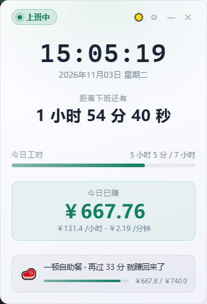

# 上班计时器

一个常驻桌面的**置顶小挂件**，告诉你现在是什么时间、处于上班的哪个阶段、距离下班还有多久、
今天已经赚了多少钱，以及"再工作多久能赚回一件 T 恤"。

支持 **Windows / macOS**，构建产物是单个可执行文件（Windows 约 11 MB，macOS 约 15 MB）。


浅色主题（白底简洁风），点右上角 🌙 / ☀️ 就能切换：



## 功能

| 需求 | 实现 |
| --- | --- |
| 时间 | 年月日 · 时分秒 · 星期，逐秒刷新 |
| 状态 | 未上班 / 午休中 / 上班中 / 已下班 / 休息日，按 8:30 上班、11:30 午休、13:00 下午上班、17:00 下班自动切换；周六周日整天是休息日 |
| 距下班 | 精确到秒的倒计时；下班后和周末显示"距下一个工作日上班还有多久"（周五晚上不会再把周六当成要上班的日子） |
| 今日已赚 | 由年薪折算日薪后按已工作时长累计；菜单里可设置年薪 |
| 赚钱速度 | 同时显示 元/小时 与 元/分钟 |
| 物品提示 | 在「今天一天赚得到、而且还没买得起」的物品里随机挑一件，显示还要多久能赚回来，并带一条进度条 |
| 工时进度 | 今日已工作时长 / 7 小时，带进度条 |
| 主题 | 深色 / 浅色（白底简洁风）随时切换，选择会被记住 |
| 窗口 | 整个窗口任意空白处都能拖动；可以最小化、置顶、退出；位置记忆支持多屏（副屏拔掉会自动居中） |
| 下班提醒 | 跨过下班点时弹一条系统通知，附上今日已赚金额（可在设置里关掉） |
| 开机自启 | 设置里可开关（写当前用户的注册表 Run 键，目前仅 Windows） |
| 单实例 | 再开一个只会把已经跑着的窗口唤起来，不会出现双宠物、配置互踩 |
| 桌面宠物 | 可选开启的**大肥鱼**（DeepSeek 鲸鱼娘桌宠，20 段透明动画）：单击回应、双击投喂、拖动悬空、闲置小动作、睡觉模式，右键可换心情包（咸鱼/元气/干饭/睡神/暴躁）与置顶开关，气泡会播报"已赚多少 / 还有多久下班 / 正在盯的物品"；窗口按角色轮廓实时裁剪、空白处点击穿透 |
| 关闭 | 右上角 ✕、右键菜单、原生菜单栏（macOS）都可以退出 |

## 计算口径

- **日薪 = 年薪 ÷ 261**（261 = 52 周 × 5 天 − 11 天法定节假日）
- **午休（11:30–13:00）不计入工时，也不发工资**
- **周六周日是休息日：不计工时、工资不涨**（法定节假日暂不识别）
- 每天实际工作 7 小时（上午 3 小时 + 下午 4 小时）
- **时薪 = 日薪 ÷ 7**，分钟薪 = 日薪 ÷ 420
- 今日已赚 = 分钟薪 × 今日已工作分钟数

上下班时间、午休时段、年薪都可以在设置面板里改，改完立刻生效——
开着宠物的话宠物也会在几秒内跟上新数字，不用重启。

## 物品提示的规则

- **候选池**：价格不超过日薪的物品 —— 也就是"今天一天赚得到"的那些。
  几千块的笔记本、一场旅行这种一天根本赚不回来的，不会出现在提示里。
- **已经买得起的不再提示**：候选池里会去掉当前已赚金额就能买下的物品。
- **不轮播**：每次换物品时随机挑一件，挑定之后就一直盯着它，
  直到买得起为止才换下一件。进度条会随着时间自己往前走。
- 提示区显示的是**还要多久**（扣掉已经赚到的部分），不是从零开始要多久。

### 内置物品清单

内置 **46 件**物品，价格从 **12 元到 4999 元**均匀铺开，每一段价位都有：

| 价位 | 例子 |
| --- | --- |
| 12 – 100 元 | 一个面包 12、一杯奶茶 18、一杯咖啡 26、打车一次 38、看场电影 75 |
| 100 – 500 元 | 洗一次车 120、一件 T恤 220、一顿火锅 300、一双运动鞋 450 |
| 500 – 1000 元 | 一次私教课 520、一件外套 660、一次年度体检 900、一套护肤品 990 |
| 1000 – 2000 元 | 一台电饭煲 1080、一台显示器 1299、一把人体工学椅 1499、一台扫地机器人 1899 |
| 2000 – 3000 元 | 一台咖啡机 2099、一台洗碗机 2499、一台空气净化器 2899 |
| 3000 – 5000 元 | 一台笔记本电脑 3299、一台相机 3999、一次家装升级 4999 |

设置面板里还能加自己的物品。

## 构建

需要 **Go 1.25 以上**（Wails v2.17 的要求；Go 会自动下载对应工具链）。

```bash
./build.sh
```

Windows 上得到 `timer.exe`，直接双击即可 —— **不会弹出黑色控制台窗口**。

> 之所以没有控制台，是因为构建时带了 `-H windowsgui`，程序被编译成 Windows GUI 子系统。
> 如果你手敲 `go build` 而忘了这个 flag，双击就会闪出一个命令行窗口。
> `build.sh` 已经处理好了，也可以用下面这条自查：
>
> ```bash
> go run ./tools/peinfo timer.exe
> # 子系统: Windows GUI —— 双击不会弹控制台窗口
> ```

### macOS

macOS 的 `.app` 包需要 Wails CLI 来打（会顺带生成 Info.plist、图标和原生菜单）：

```bash
go install github.com/wailsapp/wails/v2/cmd/wails@latest
./build.sh mac
```

产物在 `build/bin/工作计时器.app`。

> macOS 构建需要 Xcode 命令行工具：`xcode-select --install`。
> Windows 上已经装好 WebView2 运行时的话无需额外操作。

> ⚠️ **不要用不带 build tag 的 `go build`**。没有 `desktop,production` 这两个 tag 时，
> Wails 的 `CreateApp` 会直接返回空，程序启动即退出且没有任何报错。

## 使用

- **启动**：双击 `timer.exe`（macOS 双击 `工作计时器.app`）直接出窗口，不需要任何命令行。
- **拖动**：**按住窗口里任意空白处都能拖动**，设置面板也一样；位置会被记住，下次启动还在原地。
  按钮、输入框这些要点击的地方不会误拖。
- **主题**：点右上角 🌙 / ☀️ 切换深色与浅色（白底简洁风），选择会被记住；
  设置面板的「窗口与外观」里也有「浅色主题」开关。
- **最小化**：点右上角 —，窗口收进任务栏。
- **设置**：点右上角 ⚙，或右键菜单里的「设置…」，或原生菜单栏的「设置」。
  设置面板打开时窗口会变宽，保存后自动缩回。
- **退出**：右上角 ✕，或右键菜单里的「退出计时器」。
- **命令行**：`timer --settings` 启动即打开设置面板。

> 因为程序没有控制台，万一启动失败，错误会写进配置文件同目录的 `error.log`。

### 桌面宠物：大肥鱼

设置面板「窗口与外观」里打开「桌面宠物（大肥鱼）」（或主窗口右键菜单），
桌面右下角就会出现一位**鲸鱼娘**——DeepSeek 蓝色大肥鱼的娘化形象，摸鱼搭子。

- **单击**：戳一下，她会随机演一段点击回应（开心跃动 / 害羞惊讶 / 傲娇生气 / 挠痒 / 挥手）并吐槽你。
- **双击**：投喂，她随机开吃（零食 / 午餐 / 火锅 / 西瓜），吃完冒泡泡。
- **拖动**：按住她拖，会切换成「被拎起来悬空」的姿势；位置会记住（动了才写盘）。
- **右键**：菜单里有心情包（咸鱼 / 元气 / 干饭 / 睡神 / 暴躁，台词与动画行为全套换）、
  置顶开关和「收起大肥鱼」。
- **气泡**：隔一阵子她会播报「已赚多少钱」「还有多久下班」「正在盯的物品」；
  休息日会说梦话让你一起躺平。
- **自己玩**：没人理她时，隔 45–90 秒会随机来一段小动作（伸懒腰、写代码、玩魔方、吐泡泡……）。
- **睡觉**：心情包切到「睡神」时她直接睡过去（专属睡觉动画 + 梦话）。
- **热更新**：主窗口里改了年薪 / 排班 / 物品，宠物几秒内自动跟上，不用重启。

动画素材来自开源项目 [dsh-pet](https://github.com/PC2005-cloud/dsh-pet)（MIT 协议，
共 20 段 VP9 透明动画），角色形象为社区二创（一创：上善无形，二创：ZipZipPipe），
署名与授权说明随仓库保留在 `frontend/dist/pet-assets/WHALE_ATTRIBUTION.md`，
已内嵌进可执行文件、离线可用。

实现上它是**同一个 exe 的第二个进程**（`timer -pet`）：Wails v2 没有多窗口 API，
宠物跑在一扇独立的无边框、透明、可置顶的窗口里，和主进程只通过配置文件与进程生命周期打交道；
主程序退出时宠物会跟着收起来，宠物自己被收起时主程序的开关也会同步。
两边写配置都是「读盘 → 只改自己的字段 → 原子写回」，谁也不会把对方刚写的内容冲掉。

素材是 640×360 的透明视频，角色固定活动在命中框 (200,50)-(440,335) 里——窗口开成
420×285：右侧 240×285 是命中框（角色本体），左侧 180px 留给台词气泡，
气泡不再压在角色身上。视频帧每帧先清画布再画到 canvas 上屏（部分 WebView2 的
视频直渲染会丢 VP9 透明，canvas 路径不丢；不清画布快速动作会拖出残影；
为此还通过环境变量强制视频走软解）。
同时前端每 120ms 从视频帧采样 alpha 轮廓报给 Go 拼成窗口区域（`SetWindowRgn`）：
**桌宠的边缘始终跟着角色像素走**，轮廓之外的空白处连窗口都不存在，
点击直接落到下面的桌面；右键菜单展开时临时还原整窗，免得菜单被轮廓裁掉。

窗口透明还有个小机关：Wails 默认的 `WindowIsTranslucent` 在 Windows 上开的是
DWM「背景模糊」，整扇窗后面的桌面都会被糊掉；启动时会把窗口的 accent 与黑色
背景刷清掉（见 `pet.go` 的 `unblurPetWindow`），只留纯透明——角色后面是清晰的桌面。

## 配置

配置文件在 `%AppData%/work-timer/settings.json`（macOS 是 `~/Library/Application Support/work-timer/settings.json`）。
想换个位置可以设环境变量 `WORK_TIMER_CONFIG`。

里面记着年薪、上下班时间、是否置顶、主题（`theme` 是 `dark` 或 `light`）、
自定义物品、窗口位置、下班提醒与开机自启开关，
以及桌面宠物的开关、表情包、置顶与位置。

写入都是「临时文件 + 原子替换」，主进程和宠物进程同时写也不会把文件写坏。

## 代码结构

```
main.go              Wails 启动、窗口选项、原生菜单、单实例锁、-pet 参数分发
app.go               绑定给前端的门面：算状态、算薪资、处理设置、管理宠物子进程、下班提醒
pet.go               桌面宠物：第二个进程的入口与绑定（复用 app.go 的计时引擎 + 配置热加载）
platform_windows.go  Windows 专属：多屏摆位、系统通知（toast）、注册表开机自启
platform_other.go    其它平台的对应桩实现
pet_windows.go       宠物窗口的 Win32 处理：去毛玻璃、按轮廓裁窗口区域
internal/schedule/   排班与工时计算（纯函数，含周末判断）
internal/salary/     年薪 → 日薪/时薪/分钟薪，已赚金额
internal/goods/      物品清单与候选池筛选（今天赚得到、还没买得起）
internal/settings/   配置默认值、修正与原子持久化（含宠物开关/表情包/置顶/位置）
frontend/dist/       前端（纯 HTML/CSS/JS，无构建步骤；pet.* 是宠物页面）
tools/shot/          开发期抓窗口截图的小工具
tools/peinfo/        查可执行文件的 PE 子系统（确认不会弹控制台）
```

业务逻辑全部放在 Go 侧并有单元测试，前端只负责把算好的结果显示出来。

## 测试

```bash
go test ./...
```
